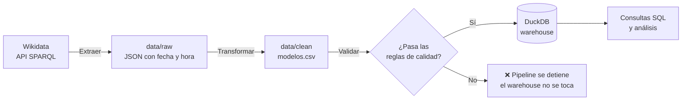
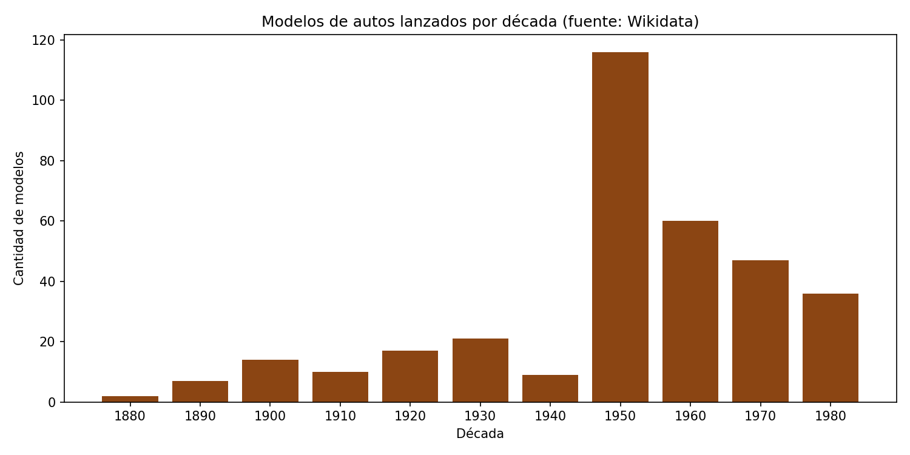
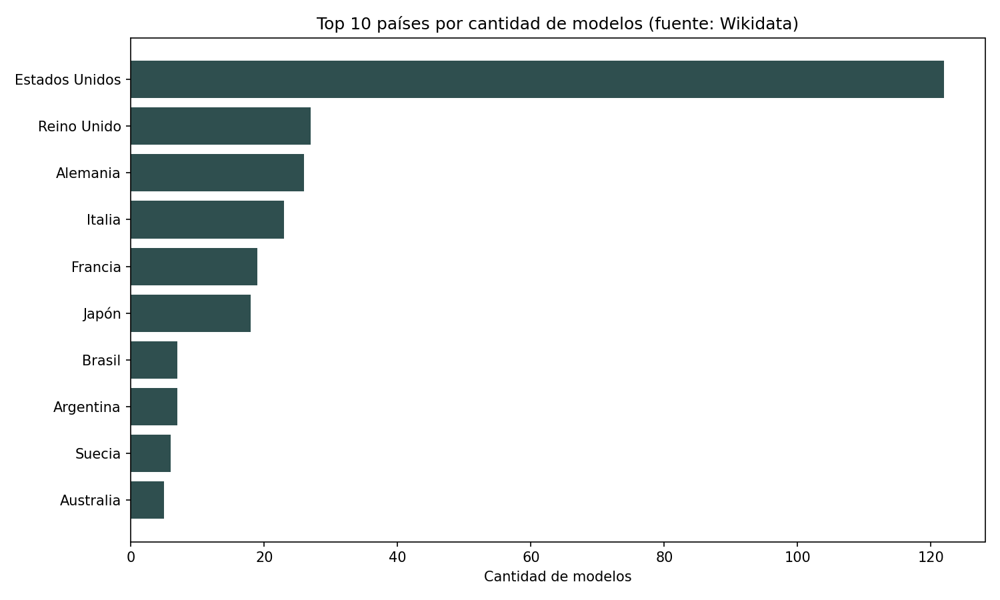

# 🚗 Pipeline ETL de Autos Antiguos

Pipeline de datos **batch** que extrae información de modelos de automóviles lanzados antes de 1990 desde **Wikidata**, la limpia y enriquece, valida su calidad y la carga en un data warehouse **DuckDB** para su análisis con SQL.

> Proyecto de portafolio de ingeniería de datos. El foco no está solo en "mover datos", sino en tomar y documentar decisiones de diseño, calidad y limitaciones como en un entorno real.

---

## ❓ Preguntas que responde

- ¿Qué países concentran más modelos de autos clásicos?
- ¿Qué país lideró el lanzamiento de modelos en cada década?
- ¿Cómo se distribuyen los lanzamientos de modelos a lo largo del siglo XX?

---

## 🏗️ Arquitectura



| Etapa | Script | Qué hace |
|---|---|---|
| **Extract** | `extract/wikidata.py` | Consulta Wikidata con SPARQL y guarda la respuesta cruda, sin modificar, en un archivo con fecha y hora. |
| **Transform** | `transform/limpiar.py` | Aplana el JSON, normaliza columnas, calcula año y década, detecta nulos disfrazados, enriquece el país y elimina duplicados. |
| **Validate** | `quality/validar.py` | Ejecuta reglas de calidad en SQL. Si alguna falla, detiene el pipeline antes de la carga. |
| **Load** | `load/cargar.py` | Carga la tabla `modelos` en DuckDB con una estrategia *full refresh* idempotente. |
| **Orquestación** | `pipeline.py` | Ejecuta las etapas en orden, mide su duración y aplica *fail fast*. |

---

## 🛠️ Stack

- **Python** (requests, pandas)
- **SPARQL** para extraer desde Wikidata
- **DuckDB** como data warehouse local
- **SQL** para validaciones y análisis (incluye funciones de ventana)
- **Git** para control de versiones

---

## 📁 Estructura del proyecto

```
autos-antiguos/
├── extract/
│   └── wikidata.py       # Extracción desde la API
├── transform/
│   └── limpiar.py        # Limpieza y enriquecimiento
├── quality/
│   └── validar.py        # Reglas de calidad de datos
├── load/
│   └── cargar.py         # Carga al warehouse
├── analisis/
│   └── consultas.py      # Consultas de análisis
├── pipeline.py           # Orquestador
├── requirements.txt
└── .gitignore            # data/ y warehouse/ no se versionan: se regeneran
```

---

## ▶️ Cómo ejecutarlo

Requiere Python 3.10 o superior.

```bash
git clone https://github.com/<tu-usuario>/autos-antiguos.git
cd autos-antiguos
python -m venv .venv

# Windows
.venv\Scripts\Activate.ps1
# Linux / macOS
source .venv/bin/activate

pip install -r requirements.txt
python pipeline.py                # ejecuta todo el pipeline
python analisis/consultas.py      # muestra los resultados
```

---

## 🧠 Decisiones de diseño

**1. El dato crudo nunca se modifica.**
Cada extracción se guarda en `data/raw/` con fecha y hora en el nombre. La limpieza lee desde ahí y escribe en `data/clean/`. Así, si cambia una regla de transformación, se puede reprocesar sin volver a llamar a la API, y cualquier resultado pasado es reproducible.

**2. Grano de la tabla: una fila por modelo.**
Un modelo puede aparecer varias veces en la respuesta de la API (por ejemplo, si su fabricante tiene más de un país registrado). Se conserva un registro por `modelo_id`, el de año más antiguo. *Trade-off asumido:* cuando un modelo tiene varios países, se conserva solo uno.

**3. Nulos disfrazados.**
Cuando un elemento no tiene nombre en español ni en inglés, Wikidata devuelve su código interno (por ejemplo, `Q12345`). Esos valores se tratan como nulos, porque no son nombres reales.

**4. Enriquecimiento del país.**
Solo una minoría de modelos tiene país de origen propio en Wikidata (inicialmente faltaba en el **83%** de los registros). Cuando falta, se usa el país del fabricante como respaldo, y así los faltantes bajaron a cerca del **15%**.
*Supuesto:* el país del fabricante no siempre coincide con el del modelo. Por ejemplo, un modelo producido en Argentina por una marca estadounidense queda asignado a Estados Unidos.

**5. Validar antes de cargar (*quality gate*).**
Las reglas de calidad se ejecutan sobre los datos limpios **antes** de tocar el warehouse. Si una falla, la tabla conserva la última versión válida. Es preferible no actualizar a publicar datos incorrectos.

**6. Carga idempotente.**
`CREATE OR REPLACE TABLE` garantiza que ejecutar el pipeline una o diez veces produce el mismo resultado, sin duplicar filas. Esto es clave cuando un orquestador reintenta tareas fallidas.

---

## ✅ Reglas de calidad

| Regla | Por qué |
|---|---|
| Al menos 100 modelos | Detecta extracciones vacías o una consulta rota. |
| `modelo_id` único | Garantiza el grano de la tabla. |
| Ningún modelo sin nombre | Una fila sin nombre no sirve para el análisis. |
| Años entre 1885 y 1989 | El automóvil se inventó en 1885–1886, y el alcance del proyecto llega hasta 1989. |
| Máximo 25% de países faltantes | Si la cobertura cae bajo ese nivel, el análisis por país deja de ser confiable. |

Las reglas se probaron forzando un umbral más estricto: el pipeline se detuvo correctamente sin ejecutar la carga.

---

## 📊 Resultados

*Ejecución del 02-11-2026: 388 registros crudos → 339 modelos limpios.*

**Top países por cantidad de modelos:** Estados Unidos (122), Alemania (27), Reino Unido (27), Italia (23), Japón (18), Francia (18).

**País líder por década:** Estados Unidos lidera en casi todas las décadas. La excepción es la **década de 1930, liderada por Alemania**.




---

## ⚠️ Limitaciones

- **Cobertura de la fuente.** La consulta exige que el modelo tenga fecha de inicio (`P571`) en Wikidata, y muchos modelos no la tienen. El dataset representa los modelos *documentados* en Wikidata, no la totalidad de los modelos que existieron.
- **Sesgo de la fuente.** Wikidata es editada mayoritariamente por comunidades angloparlantes. Es probable que los modelos estadounidenses estén sobrerrepresentados, así que el predominio de Estados Unidos debe leerse con cautela.
- **Muestras pequeñas.** Algunas décadas tienen muy pocos modelos con país (por ejemplo, 2 o 3). Las conclusiones por década en esos periodos no son estadísticamente sólidas.
- **Nulos excluidos.** Los modelos sin país quedan fuera de los análisis por país. Por ejemplo, los 2 modelos de la década de 1880 no tienen país y no aparecen en el ranking por década.
- **Fuente en vivo.** Wikidata se edita constantemente, así que dos ejecuciones en días distintos pueden dar resultados levemente diferentes. Los archivos crudos con fecha permiten rastrear esos cambios.

---

## 🚀 Próximos pasos

- [ ] Ampliar la cobertura usando otras propiedades de fecha de Wikidata.
- [x] Generar gráficos automáticamente al final del pipeline.
- [ ] Migrar la orquestación a Airflow o Dagster con ejecución programada.
- [ ] Reemplazar la transformación en pandas por modelos **dbt** sobre DuckDB.
- [ ] Agregar alertas cuando una validación falle.

---

## 👤 Autor

**Ignacio Canales Villagra**, Ingeniero en Informática
[LinkedIn](https://www.linkedin.com/in/icanalesvillagra/) · [GitHub](https://github.com/icanalesvillagra)